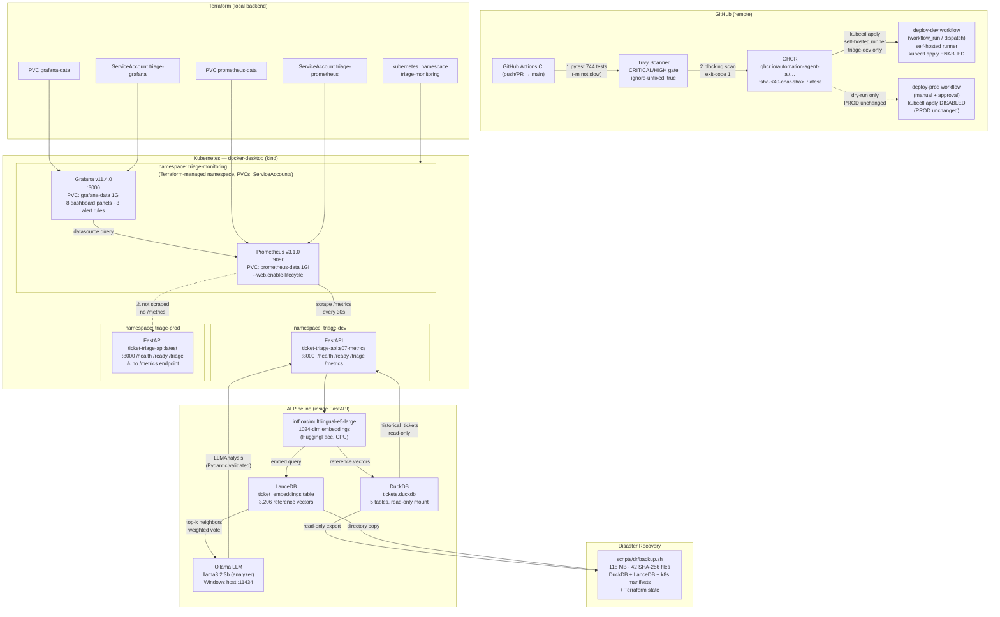

# Architecture — Multilingual Ticket Triage DevOps

**Project:** Liora — Sprint S10 Final Documentation  
**Date:** 2026-10-11  
**Branch:** `feat/s06-terraform`

---

## 1. System Overview

The system is a local, auditable AI triage agent packaged as a FastAPI service and deployed to a local Kubernetes (kind) cluster running on Docker Desktop. Every component runs on the developer's workstation — no cloud inference, no paid services, no public ingress.

```
Developer workstation (WSL2 / Docker Desktop)
├── kind Kubernetes cluster (docker-desktop context)
│   ├── namespace: triage-dev    ← FastAPI + AI agent (s07-metrics image, /metrics active)
│   ├── namespace: triage-prod   ← FastAPI + AI agent (latest image, no /metrics)
│   └── namespace: triage-monitoring  ← Prometheus + Grafana
├── Ollama (Windows host, http://host.docker.internal:11434)
└── Terraform (local backend, 5 monitoring-support resources)

GitHub (remote)
├── GitHub Actions CI (test → build → Trivy scan → GHCR push)
├── GHCR (ghcr.io/automation-agent-ai/multilingual-ticket-triage-devops)
└── deploy-dev workflow (real kubectl apply — self-hosted runner; runner pending approval)
└── deploy-prod workflow (dry-run; kubectl apply intentionally disabled)
```

---

## 2. Mermaid Architecture Diagram



---

## 3. Component Ownership by Sprint

| Component | Kind | Sprint | Owner |
|---|---|---|---|
| FastAPI application | Python + Docker | S02–S04 | Application code |
| Docker DEV/PROD images | Dockerfile | S04 | `Dockerfile` |
| Kubernetes DEV/PROD deploy | Kustomize overlays | S04 | `k8s/overlays/{dev,prod}` |
| GitHub Actions CI | Workflow | S05 | `.github/workflows/ci.yml` |
| Trivy scan + GHCR push | CI step | S05b | `.github/workflows/ci.yml` |
| Deploy-DEV workflow (real apply, self-hosted runner) | Workflow | S05c | `.github/workflows/deploy-dev.yml`, `k8s/runner/rbac.yaml` |
| Deploy-PROD workflow (dry-run, approval gate) | Workflow | S05 | `.github/workflows/deploy-prod.yml` |
| Terraform monitoring infra | HCL | S06 | `terraform/` |
| Prometheus + Grafana | Kustomize | S07 | `monitoring/` |
| Security audit + hardening | Documentation | S08 | `docs/SECURITY.md` |
| Disaster recovery scripts | Bash | S09 | `scripts/dr/` |

---

## 4. AI Pipeline Detail

```
POST /triage (ticket_id, subject, body)
        │
        ▼
preprocessing
  normalize_text → build_representation_text
        │
        ▼
NeighborRetriever
  embed query (E5-large) → LanceDB top-k cosine search
  weighted vote → NeighborPrediction (predicted queue, priority, confidence)
        │
        ▼
LocalLLMAnalyzer
  build prompt (subject + body + ontology + neighbor context)
  Ollama HTTP → generate_json → Pydantic LLMAnalysis
  max_retries=1 on schema failure → fallback on persistent failure
        │
        ▼
TriageValidator (deterministic)
  check confidence threshold (default 0.60)
  check missing_info flag
  check LLM/kNN urgency agreement
  → ValidationResult (flags, requires_human_review)
        │
        ├── trigger flags? ──Yes──▶ ConditionalLLMReviewer (disabled by default)
        │                            second-pass LLM → reviewed LLMAnalysis
        │                            accept if confidence > 0
        ▼
TriageRouter (deterministic business rules)
  missing_info       → ask_for_more_information
  requires_human_review or HIGH → escalate_to_human_supervisor
  else               → ontology.default_action(topic)
        │
        ▼
ActionExecutor (simulated — no real external calls)
  → ActionExecutionResult (status: "simulated")
        │
        ▼
TriageResult (topic, urgency, next_action, confidence, flags, action_result)
```

---

## 5. Kubernetes Namespaces and Images

| Namespace | Workload | Image tag | `/metrics` | Notes |
|---|---|---|---|---|
| `triage-dev` | `ticket-triage` | `ticket-triage-api:s07-metrics` | ✅ active | Scraped by Prometheus |
| `triage-prod` | `ticket-triage` | `ticket-triage-api:latest` | ❌ absent | Older image; not scraped |
| `triage-monitoring` | `prometheus` | `prom/prometheus:v3.1.0` | — | `--web.enable-lifecycle` (reload/quit); no `--web.enable-admin-api` |
| `triage-monitoring` | `grafana` | `grafana/grafana:11.4.0` | — | Credentials via K8s Secret |

> **Note:** `ticket-triage-api:s07-metrics` is a locally built image. It has **not** been published to GHCR. GHCR holds the `ci.yml`-built `ticket-triage-api:latest` and `sha-<sha>` tags.

---

## 6. Security Posture (Summary)

| Control | Status |
|---|---|
| Non-root container (UID 1000) | ✅ DEV + PROD + Prometheus + Grafana |
| `allowPrivilegeEscalation: false` | ✅ All containers |
| `capabilities.drop: ALL` | ✅ All containers |
| App-data volume `readOnly: true` | ✅ `k8s/base/deployment.yaml` |
| Trivy CRITICAL/HIGH gate | ✅ CI — `exit-code: 1`, `ignore-unfixed: true` |
| Secrets excluded from Git | ✅ `.gitignore` covers `.env`, `*.tfstate`, `kaggle.json` |
| Grafana credentials via K8s Secret | ✅ `secretKeyRef`; anon access disabled |
| GHCR push gated on Trivy pass | ✅ `steps.trivy.outcome == 'success'` |
| **54 unfixed HIGH OS CVEs** | ⚠ Residual — no upstream fix available at scan time |
| No NetworkPolicy | ⚠ Residual — namespaces not network-isolated |
| `readOnlyRootFilesystem: false` | ⚠ Residual — Python `__pycache__` writes |

---

## 7. Known Limitations

| Limitation | Impact |
|---|---|
| `kubectl apply` enabled in deploy-dev via self-hosted runner | Runner not yet registered (pending explicit approval); PROD remains dry-run |
| PROD image has no `/metrics` endpoint | PROD not monitored by Prometheus |
| `s07-metrics` image not in GHCR | DEV runs a locally built image only |
| Terraform state is local (`terraform.tfstate`) | State lost if disk fails; remote backend not configured |
| Prometheus snapshot requires `--web.enable-admin-api` (not present) | Live TSDB snapshots not available; metrics history is ephemeral |
| Prometheus/Grafana storage not in application DR backup | Metrics history lost on cluster reset |
| DR rollback demonstrated on nginx, not AI application | Application rollback procedure is documented but not live-tested |
| No automated backup schedule | `scripts/dr/backup.sh` must be run manually |
| No Alertmanager | Alert rules visible in Prometheus UI only; no notifications sent |
